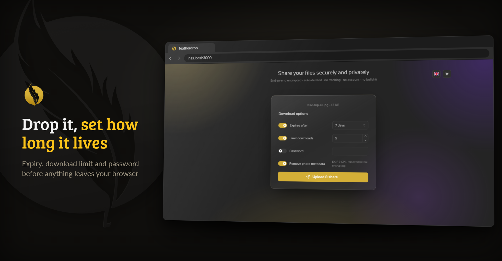
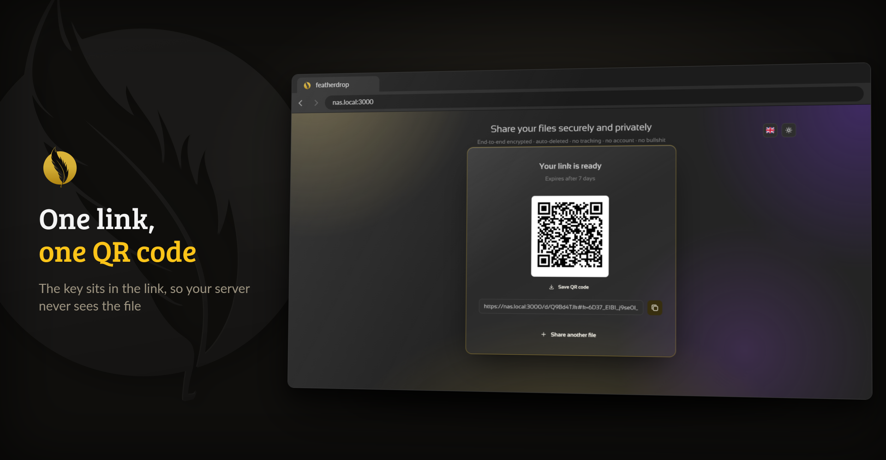
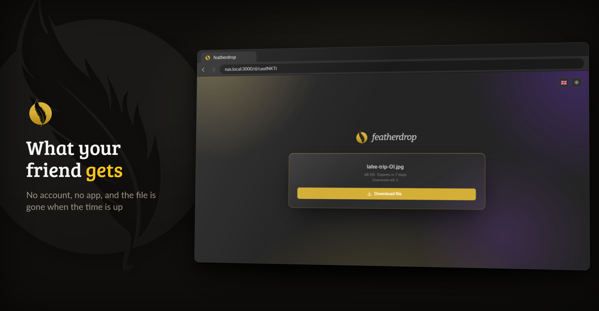

<p align="center">
  <picture>
    <source media="(prefers-color-scheme: dark)" srcset="https://raw.githubusercontent.com/junkerderprovinz/featherdrop/main/.github/assets/featherdrop-banner-dark.png">
    
  </picture>
</p>

<p align="center">
  <a href="https://github.com/junkerderprovinz/featherdrop/actions/workflows/build.yml"></a>&nbsp;
  <a href="https://github.com/junkerderprovinz/featherdrop/actions/workflows/lint.yml"></a>&nbsp;
  <a href="https://hub.docker.com/r/junkerderprovinz/featherdrop"></a>&nbsp;
  <a href="https://hub.docker.com/r/junkerderprovinz/featherdrop"></a>&nbsp;
  <a href="https://github.com/junkerderprovinz/featherdrop/pkgs/container/featherdrop"></a>&nbsp;
  <a href="https://go.dev"></a>&nbsp;
  <a href="https://mantine.dev"></a>&nbsp;
  <a href="https://ca.unraid.net/apps/featherdrop-1fxtgu11wume2t"></a>&nbsp;
  <a href="LICENSE"></a>
</p>

<p align="center">
featherdrop is a <b>feather-light</b>, self-hosted drop zone for your files. Think
<b>WeTransfer</b> or <b>Smash</b>, but it runs on your own server with no size paywall. Drop your
files (one or a whole batch), set how long they live (plus an optional password or download
limit), and share a short link or QR code. Zero-knowledge end-to-end encryption, resumable
uploads, inline previews, one tiny container. No accounts, no clouds, no tracking, no nonsense.
</p>

<br>

<p><a id="table-of-contents" href="#table-of-contents"><picture><source media="(prefers-color-scheme: dark)" srcset=".github/assets/sections/table-of-contents-dark.svg"></picture></a></p>

1. [Download](#1-download)
2. [Support](#2-support)
3. [What it looks like](#3-what-it-looks-like)
4. [What it does](#4-what-it-does)
5. [Getting started](#5-getting-started)
6. [How AI is used here](#6-how-ai-is-used-here)

<br>

<p><a id="1-download" href="#1-download"><picture><source media="(prefers-color-scheme: dark)" srcset=".github/assets/sections/1-download-dark.svg"></picture></a></p>

<!-- download-buttons: written by scripts/gen_download_buttons.py -->
<p align="center">
  <picture><source media="(prefers-color-scheme: dark)" srcset=".github/assets/sections/group-server-dark.svg"></picture>
</p>
<p align="center">
  <a href="https://ca.unraid.net/apps/featherdrop-1fxtgu11wume2t"></a>
  &nbsp;
  <a href="https://mos-official.net/apps.html?search=featherdrop"></a>
  &nbsp;
  <a href="https://github.com/junkerderprovinz/zimaos-apps#install"></a>
  &nbsp;
  <a href="https://github.com/junkerderprovinz/umbrel-apps#install"></a>
</p>
<p align="center">
  <a href="https://raw.githubusercontent.com/junkerderprovinz/featherdrop/main/compose.yaml"></a>
  &nbsp;
  <a href="https://github.com/junkerderprovinz/featherdrop/releases/latest"></a>
</p>
<!-- /download-buttons -->

<br>

<p><a id="2-support" href="#2-support"><picture><source media="(prefers-color-scheme: dark)" srcset=".github/assets/sections/2-support-dark.svg"></picture></a></p>

<p align="center">
A one-knight job: I build it, keep it running, work through the issues and add what people ask for, until nothing is missing. It is free, with no accounts, no telemetry, no ads and no paid tier. No asterisk anywhere. Nothing readable ever leaves your own walls. Forged on evenings and weekends, with heart and stubbornness.
</p>

<p align="center">
If it has earned a place on your server or computer, toss a coin to your knight: it helps cover the costs and keeps the project alive. It also makes this knight's heart beat a little faster. Three ways below, whichever suits you.
</p>

<!-- give-buttons: written by scripts/gen_download_buttons.py -->
<p align="center">
  <a href="https://buymeacoffee.com/junkerderprovinz"></a>
  &nbsp;
  <a href="https://www.paypal.com/donate/?hosted_button_id=76FVV52TKXTUS"></a>
  &nbsp;
  <a href="https://junkerderprovinz.github.io/junkerderprovinz/"></a>
</p>
<!-- /give-buttons -->

<br>

<p><a id="3-what-it-looks-like" href="#3-what-it-looks-like"><picture><source media="(prefers-color-scheme: dark)" srcset=".github/assets/sections/3-what-it-looks-like-dark.svg"></picture></a></p>

The files and links in these pictures are made up.

<p align="center">
  
  <br><em>Pick the files, then decide how long they live and how often they can be downloaded</em>
</p>

<p align="center">
  
  <br><em>The link is ready: copy it or save the QR code</em>
</p>

<p align="center">
  
  <br><em>What the recipient sees, decrypted in their browser</em>
</p>

<br>

<p><a id="4-what-it-does" href="#4-what-it-does"><picture><source media="(prefers-color-scheme: dark)" srcset=".github/assets/sections/4-what-it-does-dark.svg"></picture></a></p>

- **Zero-knowledge.** Files are encrypted in your browser before they upload (libsodium XChaCha20-Poly1305), names included. The key lives in the link's `#fragment` or comes from the share's password, so the server and anyone with its disk only ever see ciphertext.
- **Shares that clean up after themselves.** Expiry from one hour to 30 days or never, an optional download limit and an optional password. A download counts as soon as it starts, and one that breaks off picks up where it stopped, so a shaky connection doesn't waste it. Recipients of a limited link see the file names and sizes before they spend one. A private management link lets you delete a share early. Several files travel as one bundle under one link. The recipient saves them all as one ZIP, built in the browser while it decrypts, and on a share without a download limit can also pick single files.
- **Notes and file requests.** Share a text note with the same encryption and limits as a file. Or ask someone for files: they get a link to send you files without an account, and only your private collect link can open what arrives.
- **Big files are fine.** Uploads go in resumable 64 MiB chunks, so a dropped connection picks up where it stopped and a size-capped CDN such as Cloudflare does not get in the way.
- **Photos travel light.** JPEGs lose their EXIF and GPS data in the browser before encryption, unless you switch it off.
- **Pleasant to use.** Paste a screenshot with Ctrl+V, install it as an app and share to it from Android, preview images, video, audio, text and PDF before downloading, and read it all in 26 languages.
- **Safe to put online.** Per-IP rate limits, an optional daily upload cap per visitor, a storage quota, an expiry cap and an optional upload password. A strict Content-Security-Policy keeps foreign scripts off the page, and share pages tell search engines to stay away.
- **One small container.** A static Go binary on a distroless base with a single SQLite file, for amd64 and arm64, with SBOM and provenance attestations and a CVE scan on every build.

It has no user accounts, no OIDC or LDAP, no email and no S3 storage. If you need those, [Pingvin Share](https://github.com/stonith404/pingvin-share) is the bigger tool that inspired this one.

### Threat model

Everything is encrypted in your browser, so the server only ever holds ciphertext. That protects a lot, but not everything, and one part still comes down to trust. Here is where the lines are.

The server never sees your files, their names or types, or the password in readable form. The key travels in the `#` part of the link, and browsers do not send that part to the server. Shares in the v2 format pad their sizes with Padmé, so the server learns a size bucket instead of the exact size or the number of files. The upload page still writes the older formats until the new interface ships. For those the server sees the exact size, and a share protected by a password alone can be guessed offline by anyone who has its slug. [docs/encryption-format.md](docs/encryption-format.md) covers both in detail.

Whoever runs the server can still see visitors' IP addresses, when a share was uploaded and downloaded and how often, its expiry and download limit, and the size of the encrypted file. With HTTPS, someone watching the network sees that you talk to the server, when, and roughly how much data moves. Without HTTPS they can also change the page on its way to you, so put HTTPS in front of any instance you use for real. If the operator sets `APP_LOGO` to an outside URL, that host sees your IP address as well.

The weak spot is the JavaScript. Your browser runs whatever code the server sends, and a server that was broken into, or a tampered image, could send code that reads your key or your files before they are encrypted. It could even do that for a few visitors only. No web app can rule this out by itself, so featherdrop makes the code checkable instead:

- The client builds to the same bytes on any machine. CI builds it twice on Linux, Windows and macOS and compares the results.
- Every release carries `castleparcel-client.json`, with the SHA-256 of every file of the client and one root hash over all of them.
- Each instance serves the manifest of the client it embeds at `/.well-known/castleparcel-client.json` and prints the root hash in its log at startup.
- `index.html` pins its script and stylesheet with Subresource Integrity, so the browser refuses a file that does not match. The page itself is the release's template with the instance's name filled in.
- The crypto worker, which does the encryption, decryption and key derivation of every share format, is part of that pinned script. The page starts it from a `blob:` URL made from the script's own code, so there is no separate worker file to check.
- The service worker `sw-download.js` cannot be pinned that way, and it handles downloads after they are decrypted. It is in the manifest like every other file, so the check below covers it.

To check an instance against a release, run this from a checkout of this repository (Node 20 or newer):

```sh
curl -LO https://github.com/junkerderprovinz/featherdrop/releases/download/vX.Y.Z/castleparcel-client.json
node scripts/verify-client.mjs https://share.yourdomain.tld castleparcel-client.json
```

The script fetches every file, compares its hash with the release and makes sure the page differs from the template only by escaped text where the template has placeholders. For an image you have not started, `docker run --rm junkerderprovinz/featherdrop:latest -client-manifest` prints the manifest of the client inside it. [docs/verifying-the-client.md](docs/verifying-the-client.md) explains the format and how to rebuild a release yourself.

A check proves what the instance sent to you at that moment. It says nothing about what the server sends to someone else, and your browser does not compare the code with the release on its own.

The full link is the key, so anyone who has it can open the share until it expires or runs out of downloads. A few habits help:

- Send the link over a channel you trust, and the password, if you set one, over a different one.
- A chat or mail service keeps the whole link, key included, in its copy of your message. Browsers keep it in their history and may sync it.
- Pick a short expiry or a download limit, and delete the share with the management link once it has arrived. Keep the management link to yourself.

Some things are out of reach for any file sharer: malware or a hostile browser extension on the sender's or the recipient's device, a recipient who passes the link on, an operator who deletes shares or shuts the server down, and someone who watches the network long enough to match uploads to downloads.

<br>

<p><a id="5-getting-started" href="#5-getting-started"><picture><source media="(prefers-color-scheme: dark)" srcset=".github/assets/sections/5-getting-started-dark.svg"></picture></a></p>

On Unraid, install **featherdrop** from [Community Applications](https://ca.unraid.net/apps/featherdrop-1fxtgu11wume2t). Anywhere else:

```sh
docker run -d --name featherdrop -p 3000:3000 \
  -e BASE_URL=https://share.yourdomain.tld \
  -e CONFIG_DIR=/config \
  -v /path/to/data:/data \
  -v /path/to/config:/config \
  junkerderprovinz/featherdrop:latest
```

Then open port 3000 and drop a file. `/data` holds the uploads and `/config` the small database, so the two can sit on different disks. To keep both in `/data`, set `CONFIG_DIR=/data` and leave out the `/config` mount.

Put HTTPS in front of it before you share links outside your network. The browser needs a secure context for large uploads, streaming downloads and the clipboard, and over plain HTTP uploads stop at 500 MB. Set `BASE_URL` to the public address so the links point there, and in Nginx or Nginx Proxy Manager let big uploads through:

```nginx
client_max_body_size 0;
proxy_read_timeout 3600s;
proxy_send_timeout 3600s;
proxy_request_buffering off;
```

On an instance anyone can reach, `UPLOAD_PASSWORD` keeps strangers from uploading while every share link still works for its recipient. Behind a reverse proxy, set `TRUST_PROXY` to the proxy's address so the rate limits count real visitors instead of the proxy.

### Settings

Everything is set through environment variables. A value the server cannot read stops it at boot with a message that names the variable.

| Variable | Default | What it does |
| --- | --- | --- |
| `BASE_URL` | none | Public address for share links. Without it, links use the address the uploader opened. |
| `DATA_DIR` | `/data` | Where the uploaded files live. |
| `CONFIG_DIR` | `/config` | Where the SQLite database lives. |
| `PORT` | `3000` | Port the server listens on. |
| `MAX_FILE_SIZE` | `0` | Largest upload in bytes. `0` means no limit. |
| `DEFAULT_EXPIRY` | `7d` | Expiry picked for a new share: `1h`, `6h`, `1d`, `7d`, `30d` or `never`. |
| `MAX_EXPIRY` | none | Longest expiry an uploader can choose, from the same values. |
| `STORAGE_QUOTA` | `0` | Bytes all shares together may use, uploads in progress included. `0` means no limit. |
| `UPLOAD_PASSWORD` | none | Password needed to upload. Downloads never ask for it. |
| `UPLOAD_LIMIT_PER_IP` | `0` | Bytes one visitor may upload in 24 hours. `0` means no limit. IPv6 visitors count per /64. The count stays in memory under a hash that changes with every restart, so the server never keeps an address. |
| `RATE_LIMIT` | `true` | Per-visitor limits on creating uploads, on new downloads and on failed share lookups. |
| `TRUST_PROXY` | `false` | Which reverse proxies may name the visitor in `X-Forwarded-For`. `true` trusts any, or list the proxies as addresses and CIDR ranges, such as `172.16.0.0/12,10.0.0.5`. |
| `APP_NAME` | `featherdrop` | Name shown on the page and in its title. |
| `APP_LOGO` | none | Logo as an `https://` URL or an image `data:` URL. The page allows images from that URL's host and nothing else from it, and visitors' browsers load the logo from there. |
| `ACCENT_COLOR` | `#d4af37` | Accent colour as a six-digit hex value. |

### Other Docker hosts

[compose.yaml](compose.yaml) runs featherdrop on any Linux server with Docker. Put it in a folder of its own and start it with `docker compose up -d`. The folders are created next to the file.

- **Synology:** in Container Manager, create a project from the file (DSM 7.2 or newer).
- **Proxmox:** run it in a VM or an LXC container that has Docker.
- **MOS:** install featherdrop from the [MOS Hub](https://mos-official.net/apps.html?search=featherdrop).
- **ZimaOS and CasaOS:** add the [community store](https://github.com/junkerderprovinz/zimaos-apps#install) and install featherdrop from it.
- **umbrelOS:** add the [community app store](https://github.com/junkerderprovinz/umbrel-apps#install) and install featherdrop from it.

<br>

<p><a id="6-how-ai-is-used-here" href="#6-how-ai-is-used-here"><picture><source media="(prefers-color-scheme: dark)" srcset=".github/assets/sections/6-how-ai-is-used-here-dark.svg"></picture></a></p>

One knight builds this, and AI is one of the tools I work with, the same way I work with an editor or a compiler. It helps me write code and documentation and it checks my work, and that saves me a good many evenings. It does not make the decisions, though. I read and understand everything before it ships, and if something here breaks, that is on me and not on the tool.

You do not have to take my word for it. The code is open and every release note is written by hand. The issue tracker shows how problems actually get handled, including the ones I got wrong the first time. If you find something that is not right, open an issue and I will look at it.

<br>

Questions? Check the [support thread](https://forums.unraid.net/topic/199203-support-junkerderprovinz-featherdrop/). Bugs, ideas or feature requests? Please [open a GitHub issue](https://github.com/junkerderprovinz/featherdrop/issues).

<sub>The name featherdrop, its logo and its branding are not covered by the AGPL-3.0 licence of the code: a fork needs its own name and look.</sub>
